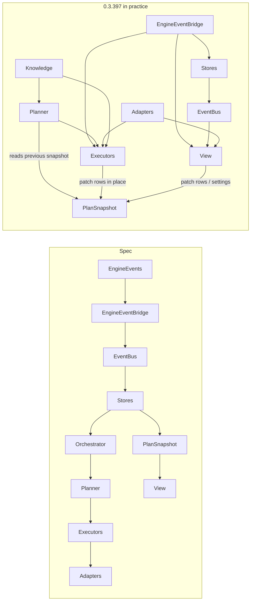

# StockPiler3 Design and Code Review (0.3.397)

Review of StockPiler3 **0.3.397** (commit `e82a3e5`): 57 Lua files plus 5 XML files, about 58,700 lines and 2.1 MB under `Source/`. It replaces the 0.3.220 review that used to be in [`CODE_QUALITY_REVIEW.md`](CODE_QUALITY_REVIEW.md); §10 re-checks each of that review's findings.

**Method.** The code was read layer by layer (Core, Adapters, Knowledge and Persistence, Stores and Planner, executors, View and Macro), plus repository-wide passes:

- `luac -p` syntax check of every file (Lua 5.1).
- A `luac -l` scan for globals that are written, or read without being defined, checked against the RoR API stubs.
- An identifier-count scan for functions that are never referenced.
- A scan for cross-module access to `_private` fields.
- Byte-for-byte comparison of copy-pasted helpers.
- A check that the `.mod` file list matches the files on disk.

Engine API usage was compared with the RoR default UI source and the `lua-stubs` in the RoR-Interface knowledge repo. One Lua-semantics claim was tested in the Lua 5.1 interpreter (§9, `RP.ExpireStuck`). Nothing was run in game.

Every **Bug** listed in §9.1 was re-read in the source. Findings marked *Unverified* need runtime evidence. Finding IDs (`CORE-n`, `ADP-n`, `KNW-n`, `PLN-n`, `EXE-n`, `VIEW-n`) are stable so that follow-up commits can reference them.

Severity scale:

- **Bug**: wrong behaviour today, or a crash path.
- **Risk**: can go wrong under realistic timing or data.
- **Smell**: makes the code harder to change safely.
- **Nit**: cosmetic.

Fix labels:

- **SAFE**: no behaviour change, so no in-game test is needed.
- **LOW-RISK**: a small, local bug fix that should get one in-game smoke test.
- **NEEDS-TEST**: changes behaviour and needs proper testing.

---

## 1. Executive summary

StockPiler3 works because it is very defensive, not because its design is sound. Almost every call is type-guarded and wrapped in `pcall`, and engine API usage matches the default UI everywhere it was checked. Engine events and the internal EventBus are registered and released symmetrically. Most hard-won client quirks are written down in comments.

The design in [`STOCKPILER3_BUILD_PROMPT.md`](STOCKPILER3_BUILD_PROMPT.md) is a one-way flow: stores feed a pure planner, which produces an immutable snapshot that the UI only reads. **That design is not what the code does.** In practice:

- The planner reads its own previous snapshot as input.
- Executors, the View and the planner itself patch the published snapshot in place.
- Adapters and Knowledge modules call upward into Grow, Brew, Planner and the View.
- 27 files reach into other modules' `_private` fields (104 references, 44 of them writes).

Correctness depends on many hand-placed invalidations and about 20 overlapping suppression timers and latches, rather than on complete generation keys.

Since 0.3.220 there has been real progress:

- The EventBus is now used for store-to-View notifications.
- The divergent plant-call branch (`TryPlantOne`) in the Orchestrator is gone.
- Helper implementations now live in `Util`.
- There is in-game `ValidateAndRepair` on load.

The large files have kept growing: `Planner.lua` went from 4,883 to 5,549 lines, `SkillUp.lua` from 3,872 to 4,657, and `StockPiler3TabWatch.lua` from 2,433 to 3,461.

**Highest-priority problems** (details in §9):

1. **Possible watch data loss.** The load-time recipe scrubs protect only the *current character's enabled* watches. A later pass deletes watches on *every* character whose recipe is missing (KNW-1).
2. **AutoBuy money safety.** Purchases that are still waiting for confirmation are not counted against the gold reserve or the lifetime allowance, and one late confirmation can be credited because a *different* item's purchase moved the money total (EXE-1, EXE-2).
3. **Latent crash.** `SeedMap.lua:989` calls `ItemSkillReq` before its `local` definition at line 2316, so the call goes to an undefined global and fails (BUG-1).
4. **Refine may use the wrong bag slot.** It calls `SendUseItem` on a slot taken from an intent cache that bag changes do not invalidate (EXE-8).
5. **A dead safety cap.** The plan rebuild cap (`PLAN_WARM_HOLD_MAX_SEC`) can never be reached, so a prewarm that keeps failing holds rebuilds indefinitely (CORE-1).

### Ratings

| Area | Rating (out of 5) | One-line verdict |
| :--- | :---: | :--- |
| Core (Scheduler, FrameWork, Orchestrator, Bus, Bridge) | 2.5 | The bus is sound; the Scheduler suppression web is the main source of fragility. |
| Adapters | 3.0 | Correct engine usage; four of six adapters also do domain work. |
| Knowledge + Persistence | 2.5 | Consistent keys, but the self-repair can delete data and the audit command mutates. |
| Stores + Planner | 2.5 | The stores are mostly right; the planner is neither pure nor immutable. |
| Executors (Grow, Brew, Refine, Buy, SkillUp, UpgradeSeed) | 2.5 | Defensive state machines; AutoBuy accounting gaps; SkillUp/UpgradeSeed copies drifting apart. |
| View + Macro | 2.5 | Clean handler and locale wiring; the View is a second domain layer. |
| **Overall** | **2.5** | Works and is cautious, but hard to reason about. Consolidate before adding features. |

---

## 2. Design and architecture against the spec



Where the code departs from the spec:

- **The planner is not pure** (PLN-2).
  - `WatchStillNeedsGrow` ([Planner.lua:1424](../Source/Planner/Planner.lua#L1424)) and `CollectFocus` read `PlanSnapshot.Get().rows` while the next plan is being built.
  - The demand and focus cache keys include the *previous* `planGen`.
  - `BuildWatchRows` carries the previous plan's SkillUp row tables into the new plan, so two snapshots share row objects.
  - As a result, output can trail its inputs by one build.
- **The snapshot is not immutable** (PLN-3, PLN-18, EXE-23, VIEW-9).
  - `TryCheapRebuild` and `TryGardenPatch` patch the old table and publish it again.
  - `RemovePlanSnapshotRowByKey` calls `table.remove` on `plan.rows`.
  - Brew, Buy, Ui and TabWatch write `craftable`, `statusKey`, `priorityTier`, `target` and `_craftableSnapGen` into published rows.
  - `plan.ctx.watches` is the live SavedVariables table.
- **Layers call upward.**
  - Knowledge calls into Planner, Watch, Grow, Refine and SkillUp (KNW old finding 2).
  - Adapters drive Ui, Grow, Scheduler, Brew session fields and SeedMap internals (ADP-2, ADP-9, ADP-17, ADP-21, ADP-32).
  - Stores call into Grow and CraftChatAdapter (PLN-13).
- **File size.** Policy, execution and view-row building share 2,500–5,500-line files. `Grow.lua:3` even says so: "Policy and executor live here".

**Assessment.** The direction the 0.3.220 review recommended still applies. It does not require a rewrite; the incremental path in §12 reaches it without breaking anything.

---

## 3. Event system

**The EventBus itself is correct** ([EventBus.lua](../Source/Core/EventBus.lua)):

- Handlers are copied before dispatch, so subscribing or unsubscribing mid-fire is safe.
- Each handler is isolated by `TryCallQuiet`.
- Tokens are unique, and `Subscribe` removes duplicates per function.

Two small costs: one table is allocated per `Fire`, and there is no recursion-depth guard (CORE-30).

**Usage today.** The old claim that the bus was "abandoned" is no longer true.

| Role | Modules |
| :--- | :--- |
| Subscribers | Ui (15 subscriptions), Scheduler (4), Brew (4), LearnBridge (3), Orchestrator (2) |
| Publishers | Inventory, Garden, PlanSnapshot, Planner, Knowledge, Vendor, RefinePipeline, Orchestrator, Bridge, Brew, Grow, Buy, TabWatch, SkillUp, TradeSkillCaps, BrewChrome |

The bus works as a store-to-View fan-out. The engine-to-store leg in the spec does not exist: `EngineEventBridge` calls stores, executors and the View directly.

**Problems:**

| ID | Severity | Finding |
| :--- | :--- | :--- |
| CORE-4 / PLN-1 | Risk | `PLAN_UPDATED` fires 2–3 times per rebuild: once from `PS.Set`, once from `PublishPlan`, and again from `PS.GetOrBuild` calling `PS.Set` a second time. It even fires when `Build` returns the cached plan. Every subscriber therefore repeats tip-cache clears, footer refreshes, `Buy.OnPlanUpdated` and `Brew.MaybeClearLoadedIfCannotContinue`. See [PlanSnapshotStore.lua:95-104](../Source/Stores/PlanSnapshotStore.lua#L95) and [Planner.lua:4442-4458](../Source/Planner/Planner.lua#L4442). |
| CORE-21 | Smell | `CMD_BREW_LOAD` and `CMD_BREW_PERFORM` are subscribed (Brew, Orchestrator) but never fired. `OP_COMPLETED` is neither fired nor subscribed. |
| CORE-30 | Smell | One garden change produces three watch-dirty marks: `GARDEN_SNAPSHOT` and `GARDEN_DIRTY` both trigger `markDirty`, and the Scheduler adds its own. |
| CORE-16 | Risk | `IsHarvestStorm()` and `IsPlantQuiet()` are queries with side effects. On expiry they set skip flags, queue a rebuild and invalidate caches, so whichever caller asks first (including `/sp3 state`) triggers the expiry work. |
| Dead fallbacks | Smell | About 25 call sites use `if Bus and Bus.FireX then Bus.FireX(...) elseif <direct window call> end`. `EventBus.lua` is loaded before all of them (it is 4th in `StockPiler3.mod`) and always defines `FireX`, so every `elseif` is unreachable. `Grow.lua:2006` inverts the pattern: it calls the window first and uses the bus only as the fallback. |
| ADP-2, CORE-27 | Smell | `TradeSkillCaps`, `Scheduler` and `EngineEventBridge` call View functions and write View-private fields directly, instead of publishing an event such as `TRADE_SKILLS_CHANGED` or `SESSION_SETTLED`. |

Engine-event registration is symmetric. `EngineEventBridge` tracks and unregisters 11 handlers, `Macro` 3, and `CraftChatAdapter` is paired through `Bootstrap`.

---

## 4. Separation of responsibilities

Across 27 files there are **104 references to another module's `_private` fields, 44 of them writes.** The most-written fields:

| Target field | Written from |
| :--- | :--- |
| `Ui._watchUiLastKey` / `Ui._watchUiFlushedAt` | Buy, Scheduler, SkillUp, TradeSkillCaps, TabWatch, TabPotions, TabPlants, StockPiler3Window (12 sites; see VIEW-13) |
| `Macro._pendingCanBrew` / `_pendingCanHarvest` / `_enabledSyncPending` | Brew, StockPiler3Window |
| `Orchestrator._fillBlocked` / `_fillBlockedWait` | Grow (in tick units, while the Orchestrator treats the value as seconds; see EXE-14 / CORE-12) |
| `Grow._harvestActionBound` / `_footerHarvestClickable` / `_harvestEnableAnnounced` | HarvestChrome, Brew |
| `Planner._closedLiveSnapGen` | Buy |
| `Scheduler._pendingBufferFlagsRebuild` | Refine |
| `UpgradeSeed._active` | WatchStore |
| `Garden._syncAllDue` | EngineEventBridge |

Responsibilities sitting in the wrong layer:

- **Planning inside executors.**
  - `Grow.PickPlantCandidate` and `CollectPlantWatchOrder` compute bottle gaps and craftable-bottle counts and run the whole priority ladder.
  - `Brew.PatchPlanRowTargetMet` re-implements the planner's seed-buffer status logic (EXE-23).
- **Planning inside Knowledge.** `RS.WatchHasSeedBufferShort` ([RecipeSpec.lua:3208-3401](../Source/Knowledge/RecipeSpec.lua#L3208)) is about 190 lines of planning logic. `RS.GrowReserveForSpec` reads Watch, SkillUp, Refine and Inventory.
- **Domain logic inside the View.**
  - `BuildStatusTooltipRows` (about 450 lines) recomputes deficits and crafts-needed.
  - `Catalog._ForgetPotionRecipeLinkLocal` deletes Knowledge and Watch entries itself; the `RS.*` functions it would delegate to do not exist.
  - Toggle handlers write settings directly.
  - TabWatch makes decisions by parsing English status text (VIEW-9 to VIEW-12, VIEW-21).
- **Persistence inside adapters.** `VendorAdapter` persists knowledge and calls `Buy.OnStoreUpdated` in addition to firing `VENDOR_UPDATED`. `ApothecaryAdapter` writes Brew session fields (ADP-21, ADP-32).
- **Side effects in diagnostics.**
  - `Buy.DumpBuyPlan` can reset or stop the vendor visit (EXE-6).
  - `Grow.DumpDiagnostics` can post a stall chat message and play a sound (EXE-15).
  - `/sp3 audit` mutates saved data (KNW-20).

---

## 5. Duplicate and mergeable code

### 5.1 Copy-pasted helpers

Each line was compared byte-for-byte, after trimming whitespace.

| Helper | Copies | Variants | Note |
| :--- | :---: | :---: | :--- |
| `T` | 17 | 3 | 14 delegate to `Util.T`. `Planner.lua:32` and `BrewLearn.lua:508` fall back to the bare key without `[...]`, and `Classify.lua:68` falls back to effect short names. |
| `ToNarrow` | 14 | 3 | All delegate to `Util.ToNarrow`; they differ only in parameter name. `BagAdapter` `ItemLabel`/`NarrowField` re-implement it (ADP-10). |
| `NowSec` | 9 | 1 | All identical wrappers over `Util.NowSec`. |
| `TryCall` / `TryQuiet` | 6 / 4 | 3 / 2 | `FrameWork.lua:20`'s `TryCall` actually calls `TryCallQuiet`; the name does not say so. |
| `StageEmpty` | 5 | 1 | An identical 6-line body in Grow, CraftChatAdapter, CultivatorAdapter, LearnBridge and CraftTooltip. |
| `IconMarkup` | 5 | 2 | `CraftHarvestTimer` returns `nil` without a trailing space; the other four return `L""` with one. |
| `RowCraftableGreen` | 3 (+1) | 1 | TabWatch, BrewTooltip and Brew. Brew's `RowCanPrematureLoad` is identical (EXE-24, VIEW-17). |
| Trade-skill / backpack-type ids | 5 | — | ApothecaryAdapter, CultivatorAdapter, BagAdapter and VendorAdapter each hard-code fallbacks: Apothecary 4, Cultivation 3, inventory 2, craft bag 4 (ADP-26). |
| Account table lists | 3 | 3 | `Settings.lua:10` includes `skillUpRates`; the copies in KnowledgeStore and Bootstrap do not. This is the drift class the comment at `Settings.lua:39-40` warns about (KNW-12). |

**Old finding 3.3 is partly fixed.** There is now one implementation of each helper, but thin local shims remain. They are cheap, so keep them as aliases such as `local NowSec = StockPiler3.Util.NowSec`. The real duplicates are `StageEmpty`, `IconMarkup`, `RowCraftableGreen`, the `T` variants and the trade-skill id lookups.

### 5.2 SkillUp vs UpgradeSeed

This is partly fixed since 0.3.220. SkillUp now delegates `SeedDeficit`, `CountEmptyPlots`, `PlantableSurplus` and `ScanUpgradePlant` to UpgradeSeed, and genus-ladder merging lives only in UpgradeSeed. Parallel copies that remain:

| Concern | SkillUp | UpgradeSeed | Drift |
| :--- | :--- | :--- | :--- |
| Plant watches stocked | `AllEnabledPlantWatchesStocked` (187) | `PlantsStockedForUpgradeIdle` (852) | **Yes.** A watch with `plantUid = 0` blocks SkillUp but is skipped by UpgradeSeed (EXE-28). |
| Seed buffer ok | `SeedBufferOk` (222) | `SeedBufferOkForIdle` (843) | Identical. |
| Idle gate | `WatchesAllowIdleSkillUp` (488) | `WatchesAllowUpgradeClimb` (889) | Similar. |
| Floor tier | `FloorCultTier` (76) | `US.FloorCultTier` fallback (70) | **Yes.** The UpgradeSeed fallback returns 0 where SkillUp returns 1. The fallback never runs, because SkillUp is always loaded (EXE-29). |
| Refine intents | `AppendRefineIntents` (1481) | same (1658) | Parallel. |
| Buy jobs | `CollectBuyJobs` (1684) | same (1751) | Parallel. |
| Stall notice | `MaybeNotifyStall` (1811) | same (1829) | Parallel; the sound code is copied inline. |
| Plant job | `PickPlantJob` (1090) | same (1343) | Parallel. |
| Best owned seed | `PickBestBagSeed` (854) | `PickBestOwnedSeed` (1038) | **Different ranking.** |
| Rung lookup by skill requirement | 756, 842, 3030 | 293, 532, 565 | Six copies. |
| Watch status rows | `BuildWatchStatusRows` (4646) | same (2273) | Parallel, and View work inside a domain module. |

`Core/SeedEconomy.lua` was meant to be the single owner, but only `SkillUp.lua:1034` uses it. Its `SeedDeficit`, `PlantableSurplus` and `CountEmptyPlots` have no callers, and its header comment is wrong (CORE-22, EXE-34).

### 5.3 Other mergeable code

- **Planner:**
  - `WarmHave` and the first `WarmHave` slice are near-identical in their pending-collect and bag passes (PLN-16).
  - `TryCheapRebuild` and `TryGardenPatch` share their guards and their republish tail (PLN-17).
  - The two seed-resolve chains in `CollectAutoGrowSeedLines` have already drifted apart (PLN-19).
- **"Live recount" logic is copied in 5 places** (Brew, Buy, two in Ui, TabWatch). Each invalidates stamps, patches the plan rows, and patches `listData` if it is a different table (PLN-18).
- **The plot-credit fallback chain** (`CountSeedPlotCredit`, falling back to `CountInGroundSeeds`) is pasted 7 times. The fallback can never run (EXE, old finding (d)).
- **Three near-identical "has AutoGrow work" predicates:** `Orch.HasAutoGrowWork`, `Sch.ShouldWakeAutoGrowUrgent` and `Sch.ShouldWakeAutoGrow` (CORE-18).
- **Two fill-block states:** Grow and Orchestrator each keep one, in different units, decayed by two functions on the same tick (CORE-12, EXE-14).
- **Status colours** are defined twice, as an if-chain and as `STATUS_TIP_COLORS`. The table is missing `skill_done`, so that tooltip title shows grey instead of green (VIEW-16).
- **Tooltip helpers** are spread across five tooltip files: `SessionBrewName`, `ReadyName`, `SoftReadyCount`, `RgbDef`, the blocked-reason switch, and the row-lookup helpers (VIEW-19).
- **Skill-requirement extraction** is written out 9 times in SeedMap and RecipeSpec, although SeedMap already has `ItemSkillReq` (KNW-13).

---

## 6. Data integrity and persistence

Checked and correct:

- UID keys are consistently `tostring(uid)` in `items`, `grows`, `products`, `refines`, `seedOut` and `outcomes`.
- Numeric bonus keys round-trip through SavedVariables.
- Migrations are latched and run before other modules read saved data.
- Shutdown strips Account keys that are not on the allowlist.
- No `pairs` loop adds keys to the table it is traversing.

Problems:

| ID | Severity | Finding |
| :--- | :--- | :--- |
| KNW-1 | **Bug** | `WatchReferencedRecipeKeys` ([RecipeSpec.lua:2204](../Source/Knowledge/RecipeSpec.lua#L2204)) protects recipes used by the current character's *enabled* watches only. `ScrubSubsetPotionRecipeKeys` and then `ScrubOrphanSubsetRecipes` can remove another recipe. Later, `RematerializeRecipeFingerprints` ([RecipeSpec.lua:3010-3030](../Source/Knowledge/RecipeSpec.lua#L3010)) walks **all characters** and drops any watch whose recipe is missing. Disabled watches and other characters' watches can be lost, and validation gives different results on repeated runs. The same chain also runs after brews. |
| KNW-2 | **Bug** | `_repairQuarantine` is written onto `Account`, but it is not in `ACCOUNT_ALLOWED` ([Settings.lua:41-47](../Source/Persistence/Settings.lua#L41)), so Shutdown strips it. Anything "quarantined" is gone after a reload. The log message points at a key that won't exist, and `/sp3 audit` always reports it as unexpected. |
| KNW-20 | Risk | `/sp3 audit` is not a dry run: it calls `ValidateAndRepairSavedData`, which merges and deletes. Combined with KNW-2, what it removes cannot be recovered. |
| KNW-7 | Risk | `Items.ToSpec` returns the persisted `bonuses` table by reference. `StampIncompleteMainEffect` then writes `spec.bonuses[6]` straight into `Account.items`, bypassing `StoreItem` and `Touch`. |
| PLN-10 | Risk | `Inv` enrich code writes iLevel, skillReq, craftingBonus and other fields into the bag table it gets from `DataUtils.GetItems()`, which the default UI also uses, without bumping `snapGen`. |
| PLN-11 | Risk | `WatchStore.lua:519-524` writes `recipe.outputUid` into a persisted Account recipe during what should be a read-only skill check. Watches that share the recipe overwrite each other's value. |
| KNW-3 / KNW-4 / KNW-5 / KNW-6 | Risk | Wrong attribution while learning:<br>• Every positive bag change during a harvest window is stored with the sticky `kind="plant"`, even when the harvest code rejected it as unrelated.<br>• Back-to-back harvests overwrite the single `_pendingHarvest`.<br>• The 45-second brew re-arm window credits vendor, loot or mail potions to the last recipe.<br>• A stale `skillUpOrigin` latch silently skips the next manual brew's learn. |
| KNW-8 | Risk | Incomplete-main identity has neither uid nor effect. Different-effect stubs with the same stats collide and are merged irreversibly on load. How often this happens is unverified. |
| KNW-19 | Risk | The ladder tier guards *fail open* when a seed's skill requirement is unknown (0), and `HealFamilyRungSeeds` has no tier check at all. The climb-link repair script was written for this class of problem. |
| KNW-14 | Smell | `recipeKeys` and `alternateRecipeSpecKeys` point at the same table, so every list of roughly 400-character keys is serialised twice. The active key is stored three times. |
| KNW-9 | Smell | `Account.additives` is written but never read, and its only input carries no stats. |
| KNW-15 | Risk | `GetCharacterBucket(true)` can create a `_default` bucket if it runs before the player name is known; such a bucket exists in the live SavedVariables. |
| KNW-17 | Smell | The defaults do not describe what is persisted (`plantWatches`, `watchPriorityTiersMigrated` and the plant sort keys are missing). Retired character keys are never removed. `accountVersion`, `settingsVersion` and `charactersVersion` are written but never read. |
| ADP-1 | Risk | `TradeSkillCaps.OnTradeSkillPulse` treats a reading of 0 from `GetTradeSkillLevel` as "explicit" and persists it, which contradicts the file's own comment that levels "can blip to 0 in combat/scenario". Whether the engine actually returns 0 rather than nil is unverified. |
| PLN-7 | Bug | In `RP.ExpireStuck`, the hard clear happens one frame after the "soft" clear, because the function runs every frame, so the grace period does nothing. `row.at` is also not refreshed for later refines of the same seed. |
| PLN-8 / PLN-9 | Risk | `Inv._dirty = false` in the per-slot path drops unrelated pending rebuild requests. The underflow path sets `_dirtyFull` without queueing a flush. |
| EXE-1 / EXE-2 / EXE-3 | **Bug** | AutoBuy accounting; see §9. |

### Offline repair scripts (`tools/`)

Every hardcoded `C:\Games\Return of Reckoning` path in these scripts no longer exists.

| Script | Verdict |
| :--- | :--- |
| `deploy.ps1`, `waremu_special_mats_probe.py` | Keep. |
| `_audit_sv.lua` (untracked) | Keep and commit after refreshing it. It is read-only, which the in-game audit is not. Its V5-latch and bonus-noise checks are out of date. |
| `_scrub_skillup_origin_sv.py` | **Remove: dangerous.** By default it restores a 2026-09-21 backup over the live SavedVariables. SkillUp learns are now blocked in game. |
| `_repair_climb_links_sv.py`, `_verify_climb_sv.py`, `_fix_enabled_and_clean_sv.py`, `_check_nulls.py`, `_audit_sv_sections.py`, `_audit_settings_watches.py`, `_audit_watches_now.py`, `_audit_watches_enabled.py`, `_audit_plant_watches.py`, `_dump_plant_watches.py`, `_extract_wake_timeline.py`, `_verify_recovery.py` | Obsolete. They are one-off scripts with hardcoded UIDs, character names or backup paths. `_check_nulls.py` diagnosed NUL padding that the scripts themselves wrote. |
| `_wake_timeline.txt` | An empty file that is already in `.gitignore`. Delete it. |

---

## 7. Stale code

**Module functions with no reference anywhere in `Source/`.** Each was confirmed by an identifier count over all Lua and XML:

| Function | File | Note |
| :--- | :--- | :--- |
| `SkillUp.LevelRate` | [SkillUp.lua:2093](../Source/SkillUp.lua#L2093) | Replaced by `ResolveLevelRate`. |
| `Items.MigrateStampMainEffectsFromDescriptions` | [Items.lua:549](../Source/Knowledge/Items.lua#L549) | Marked `@deprecated`. |
| `RS.MigrateRecipeFingerprintsV5` | [RecipeSpec.lua:3124](../Source/Knowledge/RecipeSpec.lua#L3124) | Marked `@deprecated`. It writes `recipeFingerprintMigrateV5`, which Shutdown strips. |
| `SM.InvalidateFamilyLadderCache` | [SeedMap.lua:2700](../Source/Knowledge/SeedMap.lua#L2700) | |
| `Locale.GetLanguage` | [Locale.lua:67](../Source/Locale/Locale.lua#L67) | |
| `Garden.MarkSoftDirty` | [GardenStore.lua:241](../Source/Stores/GardenStore.lua#L241) | |
| `Inv.Flatten` | [InventoryStore.lua:383](../Source/Stores/InventoryStore.lua#L383) | |
| `HarvestChrome.FireHarvestAction` | [HarvestChrome.lua:155](../Source/View/HarvestChrome.lua#L155) | Duplicates `Macro.FireHarvestActionPreferred`. |
| `StockPiler3TabWatch.IsBoundToPlanRows` | [StockPiler3TabWatch.lua:401](../Source/View/StockPiler3TabWatch.lua#L401) | |

These were also found never called by reading their callers:

- `AA.UnparkApoRoot` and `AA.PlaceApoOnScreen` (ADP-22).
- `RP.Clear`.
- `FW.Shutdown`, `Bridge.Initialize` and `Bridge.Shutdown` (CORE-23).
- `SE.SeedDeficit`, `SE.PlantableSurplus` and `SE.CountEmptyPlots` (CORE-22).
- The `Watch.GetCharacter` alias.

**Unreachable branches and write-only state:**

- **`elseif` fallbacks after `Bus.FireX`** (about 25 sites; §3) and the fallbacks to functions that do exist: `HarvestNext`, `BrewClick`, `MarkSyncAllDue`, `BeginWarmHaveSlice`, `InvalidatePlantQueue`, `MarkAwaitingSessionLoad` (CORE-24).
- **The FrameWork seed-lines prewarm job is a no-op.** It calls `Grow.WarmSeedLines` and `Grow.CollectAutoGrowSeedLines`, which do not exist; the real function is on Planner and RecipeSpec. It still occupies a pump frame, sets `didHeavy`, and keeps `IsPrewarmBusy()` true. `Planner.WarmDemand` does not exist either (CORE-13, [FrameWork.lua:233-253](../Source/Core/FrameWork.lua#L233)).
- **Scheduler `_holds`:** `Sch.Hold` writes it and `Advance` prunes it, but nothing reads it (CORE-6).
- **Brew post-brew clear:** `Brew._postBrewClearArmed` is only ever assigned `false`, so `Brew.OnInventorySnapshot` always returns at its first line and about 45 lines plus a bus subscription are dead (EXE-21).
- **Grow plant-commit and wave tracking:** `Grow._seedCommitted` is always 0 between calls. `_wavePlantedBySeed` is written but never read. `_plantFailCooldownUntil` is written but never read, so `UNCONFIRMED_PLANT_COOLDOWN_SEC` is never enforced (EXE-12, EXE-13).
- **Unconsumed plan fields:** `plan.growJobs`, `refineIntents`, `brewBlocks` and `reservations`, and with them the whole output of `Reservations.lua`, have no reader. That file's header says Grow, Refine and Buy use them (PLN-22, PLN-25).
- **`RP._outstanding` legacy row shape:** the branches for non-table rows can never run, because `MarkPending` always stores tables (§9.3).
- **`BagAdapter` writes to `DataUtilsData`:** the default UI declares that table `local` (`datautils.lua:23`), so these lines never run (ADP-7).
- **The Perf logger** can never be enabled without LibPerf: nothing calls `SetEnabled`, and Settings removes `perfEnabled` (CORE-23).
- **Migrations V2–V4:** they still run on every load, but new Accounts are created with their latches already `true` ([Settings.lua:43-45](../Source/Persistence/Settings.lua#L43)). They are now covered by `ValidateAndRepair` and could be retired once all SavedVariables have been loaded at least once on 0.3.360+.
- **Unused locale keys:** `watch.chip_load` and `watch.tip_load`. No referenced keys are missing.

---

## 8. Comment relevance and correctness

The comments are plentiful, and most explain real client quirks. Some are wrong:

| Location | Problem |
| :--- | :--- |
| [Planner.lua:2-3](../Source/Planner/Planner.lua#L2) | It says "pure gen-keyed plan … (Lua 5.0)". The planner is not pure (§2), and the client runs Lua 5.1. |
| [Reservations.lua:2-4](../Source/Planner/Reservations.lua#L2) | It says priority-ordered allocation "for Grow/Refine/Buy". Nothing reads the reservations, and `FillWatchRowCraftable` does not order by priority. |
| [SeedEconomy.lua:2-3](../Source/Core/SeedEconomy.lua#L2) | It says Grow, Refine, UpgradeSeed and SkillUp "all consult these". Only SkillUp does. |
| [Orchestrator.lua:3](../Source/Core/Orchestrator.lua#L3) | The documented tick order leaves out the buy step that runs first when the vendor is open. |
| [FrameWork.lua:3](../Source/Core/FrameWork.lua#L3) | It says results are "Published only in done()". No job uses `done`; WarmHave publishes inside `resume`. |
| [Scheduler.lua:764](../Source/Core/Scheduler.lua#L764) | The `or 0.75` fallback contradicts `PLANT_QUIET_BASE_SEC = 1.25`. The same mismatch is in Brew (`LOAD_SETTLE_SEC or 0.75` against 1.25; EXE-25). |
| [Orchestrator.lua:423-426](../Source/Core/Orchestrator.lua#L423) vs [Scheduler.lua:397-400](../Source/Core/Scheduler.lua#L397) | The Orchestrator comment says fast ticks continue while fill is blocked, but the Scheduler forces a 5-second tick whenever fill is blocked (CORE-11). |
| [RecipeSpec.lua:3171](../Source/Knowledge/RecipeSpec.lua#L3171), [KnowledgeStore.lua:61](../Source/Stores/KnowledgeStore.lua#L61) | The first says only "Grow/Refine call" these shims (Planner, Brew, UpgradeSeed and SkillUp do too). The second says "Idempotent", which KNW-1 contradicts. |
| Misplaced doc comments | `VendorAdapter.lua:23` (describes `LearnVendorRows`), `Items.lua:154` (describes `StoreItem`), `RecipeSpec.lua:2862` (describes `RematerializeRecipeFingerprints`). |
| Macro.lua:132, 1461-1464 | Say "SP2" where they mean SP3. |
| Version-stamped history (8 comments: `0.3.89` to `0.3.348`) and 19 SP1/SP2 references | Mostly useful as regression notes. Rewrite the ones that tell history, such as "used to return before…", as the constraint itself (ADP-24, EXE-35). |

---

## 9. Bugs

### 9.1 Confirmed bugs

Each of these was re-read in the source after the layer review reported it.

| # | ID | Severity | Location | Finding | Fix label |
| :--- | :--- | :--- | :--- | :--- | :--- |
| 1 | KNW-1 | High | `RecipeSpec.lua:2204`, `3010-3030` | Watch loss through the subset scrubs (see §6). | NEEDS-TEST |
| 2 | EXE-2 | High | [Buy.lua:1262-1263](../Source/Buy.lua#L1262) | The reserve and allowance headroom ignore the cost of other items' purchases that are still unconfirmed. When those land, money can drop below the reserve and lifetime spend can pass the hard allowance. | NEEDS-TEST |
| 3 | EXE-1 | High | `Buy.lua:452-497` | A late confirmation passes its money test if *any* other confirmed purchase lowered money, so spend is over-counted and a false "bought" chat line appears. | NEEDS-TEST |
| 4 | BUG-1 | High (crash) | [SeedMap.lua:989](../Source/Knowledge/SeedMap.lua#L989) | `ItemSkillReq(item)` is called inside `SM.ResolveSeedUidForPlant`, but `ItemSkillReq` is a `local` defined at line 2316. At line 989 the name refers to an undefined global, so this errors with `attempt to call global 'ItemSkillReq' (a nil value)` whenever a bag or account seed has no `craftingSkillRequirement`, `skillReq`, `skillLevel` or `bonuses[9]`. `luac -l` shows the `GETGLOBAL`. | LOW-RISK |
| 5 | EXE-8 | High | `Refine.lua:123-153`, `1340-1423` | The intent cache is not keyed on `snapGen`, and `IssueOne` calls `SendUseItem(location, slot)` on the slot cached at collection time without checking it still holds the plant. Whether slots shift within the cache's lifetime is unverified. | NEEDS-TEST |
| 6 | KNW-2 | Medium | `RecipeSpec.lua:2865`, `Settings.lua:41` | The repair quarantine is stripped at Shutdown. | LOW-RISK |
| 7 | CORE-1 | Medium | [Scheduler.lua:303-340](../Source/Core/Scheduler.lua#L303) | Both `IsPrewarmBusy()` returns come before the hold-cap code, and `RequestCachePrewarm` always leaves a prewarm busy, so `PLAN_WARM_HOLD_MAX_SEC` is unreachable. If warming keeps failing, rebuilds are held indefinitely. | NEEDS-TEST |
| 8 | CORE-3 | Medium | [EngineEventBridge.lua:288-299](../Source/Core/EngineEventBridge.lua#L288) | `prev.cult` and `prev.apo` are overwritten before `liveDrop` reads them, so a real drop (e.g. 200 to 0) is never detected and the next pulse records a +200 skill-up delta. Usually masked because `OnLoadingEnd` clears `_skillPrev` first. | LOW-RISK |
| 9 | CORE-4 / PLN-1 | Medium | `PlanSnapshotStore.lua`, `Planner.lua:4442` | `PLAN_UPDATED` fires 2–3 times per rebuild, including on cache hits. | NEEDS-TEST |
| 10 | CORE-2 | Medium | `Scheduler.lua:1132-1158` | The tick accumulator is consumed even when the Orchestrator tick is skipped for heavy work, so a whole 1-second or 5-second tick is lost. This makes CORE-13's no-op prewarm frames worse. | NEEDS-TEST |
| 11 | CORE-13 | Medium | [FrameWork.lua:244-253](../Source/Core/FrameWork.lua#L244) | The seed-lines prewarm is a no-op that still costs a heavy frame. | LOW-RISK (remove it) |
| 12 | VIEW-1 | Medium | [Macro.lua:1660-1666](../Source/Macro/Macro.lua#L1660), 1692-1703 | On our Craft or Harvest button, the disabled and idle branches return before the cursor check, so dropping an item or ability onto that slot is swallowed instead of reaching the default `CursorSwap`. | LOW-RISK |
| 13 | VIEW-2 | Medium | `Macro.lua:240-262` | `FindMacroSlot`'s fallback accepts a matching name *or* a matching text, so a user macro named "StockPiler3 Craft" with different text is overwritten at every login. | LOW-RISK |
| 14 | ADP-19 | Medium | [ApothecaryAdapter.lua:501-504](../Source/Adapters/ApothecaryAdapter.lua#L501) | `_sp3Opening` is set around an unprotected `InitHeadlessSession()`. If that throws, the flag stays set and the player's Apothecary ability is swallowed until the window closes. | LOW-RISK |
| 15 | ADP-20 | Medium | `ApothecaryAdapter.lua:520-536` | `CloseWindow` clears the board and releases slot locks *before* deciding whether the session belongs to SP3, so it can wipe a player's own visible Apothecary board. | NEEDS-TEST |
| 16 | EXE-20 | Medium | Brew 2894-2901, Grow 1674-1677 | A manually loaded board is never unloaded automatically. The phase stays "loaded", so `Orch.IsBrewSessionActive()` stays true and AutoGrow stops planting. This may be intended. | NEEDS-TEST |
| 17 | PLN-7 | Low | `RefinePipelineStore.lua:160-173` | The soft grace period does nothing (see §6). | NEEDS-TEST |
| 18 | VIEW-16 | Low | `StockPiler3TabWatch.lua:2496` | `skill_done` is missing from `STATUS_TIP_COLORS`, so that tooltip title is grey instead of green. | SAFE |
| 19 | KNW-16 | Low | `SeedMap.lua:1738` | `tonumber(seedUid) or SM.ResolvePlotSeed(...)`: when the value is 0, `tonumber` returns 0, which is truthy in Lua, so the fallback never runs. | LOW-RISK |

### 9.2 Reported risks

These are risks rather than bugs; each is cross-referenced here and detailed above.

- **Adapters:**
  - ADP-12: English crafting-chat cues may also fire on brews.
  - ADP-13: all chat patterns are English-only.
  - ADP-16: the chat filter accepts every channel if `ChatLogFilters.CRAFTING` is missing.
  - ADP-33: `VA.BuyItem` has no buyback-tab guard; only its caller checks.
  - ADP-35: the store list may be read before the default UI refreshes it.
- **Executors:**
  - EXE-3: late attempts are reset when the vendor reopens, so a purchase that lands late is never counted.
  - EXE-9: a refine is marked as failed if Grow plants the delivered seed first.
- **Core:**
  - CORE-5: the decision hold causes a rebuild about every `PLAN_MIN_GAP_SEC` while AutoGrow has work.
  - CORE-9: an `urgent` rebuild is downgraded behind the bag flush.
  - CORE-14: the additive wake has no storm or quiet guard.
  - CORE-15: one `pcall` covers the whole frame pipeline, so one error skips the rest of the frame.
  - CORE-17: the refine-first path still plants when refine fails.
- **View:**
  - VIEW-4: the `UpdateIcon` restore clobbers later hookers.
  - VIEW-5: the `UpdateInventory` wrapper paints every ActionButton with no `pcall` and may scan 48 macro slots per button.
  - VIEW-6: re-entrancy latches are not exception-safe.
  - VIEW-20: `Tooltips.NUM_ROWS` is raised globally from 17 to 80.
  - VIEW-21: decisions are made by parsing English status text.

### 9.3 Claims that turned out not to be bugs

- **`RP.ExpireStuck` changing the table inside `pairs`** (old finding 4.1). In Lua 5.1, assigning to or clearing *existing* keys during `pairs` is defined behaviour. The loop's `tonumber(seedUid)` would add a *new* key during traversal, and so miss the delete, only if the key were a string. That was checked:
  - Every writer (`MarkPending`, `Reconcile`, `ExpireStuck`, `Clear`) normalises keys to positive numbers.
  - The table is session-only and never persisted.
  - Running the string-key case in Lua 5.1 confirmed the concern is real only for string keys: all 64 string-keyed rows were left in place.

  So the code is correct today. The re-keying and the non-table branches are dead defensive code.
- **`SendUseItem` hook in LearnBridge.** It is the only global written outside SP3's own names. It wraps the engine function, preserves its arguments and calls the original.

---

## 10. Status of the 0.3.220 findings

| Old § | Claim | Status at 0.3.397 | Evidence |
| :--- | :--- | :--- | :--- |
| 1.1 | EventBus abandoned; only LearnBridge and Orchestrator subscribe | **Fixed** | 28 subscriptions across Ui, Scheduler, Brew, LearnBridge and Orchestrator; 16 publishers (§3). |
| 1.1 | Executors, bridge and planner call `StockPiler3Window.*` directly | **Partially fixed** | Most go through the bus now, but dead `elseif` direct calls remain. `Grow.lua:2006` calls `SyncActionReadiness` first. Scheduler and Bridge still call the View (CORE-27). |
| 1.1 | RecipeSpec and SeedMap reach up into stores and Planner | **Still open** | KNW old finding 2. |
| 1.2 | God files | **Worse** | Planner 4,883 to 5,549; SkillUp 3,872 to 4,657; TabWatch 2,433 to 3,461; Brew 2,307 to 3,146; SeedMap 3,059 to 3,173; UpgradeSeed 2,287 to 2,510; Grow 2,632 to 2,612. |
| 1.3 | 15+ interlocking suppression flags | **Partially fixed** | `_skipOrchThisFrame` is gone. Two were added (`_orchDecisionHoldTicks`, `_pendingBufferFlagsRebuild`). The table in the Core review lists about 20, of which `_holds` is write-only, storm is a subset of quiet, and `_skipUiHoldFooter` can be merged (CORE-6, CORE-10). |
| 1.4 | Plan and UI held while `FW.IsPrewarmBusy()` | **Still open, and worse** | The cap that looks like a bound is unreachable (CORE-1). |
| 2.1 | `Grow.PickPlantCandidate` does planning | **Still open** | §4. |
| 2.1 | RecipeSpec Planner shims | **Partially fixed** | `CollectAutoGrowFocus` is gone. `BuildBalancedSpecDemand`, `WatchStillNeedsGrow` and `CollectAutoGrowSeedLines` remain as forwarders; Planner calls itself through them (PLN-20). `WatchHasSeedBufferShort` is now about 190 lines of real logic. |
| 2.2 | Brew and Buy mutate `PlanSnapshot` rows | **Still open, and wider** | Planner, Ui and TabWatch also mutate rows (PLN-3). |
| 2.3 | TabWatch holds business logic | **Partially fixed** | Recount and reconcile moved to Planner; tooltip logic, row synthesis and text parsing remain (VIEW old finding). |
| 2.4 | Private-field coupling | **Still open** | 104 cross-module references, 44 writes (§4). The `Grow.MarkPlantJobProbed` call is now a documented API; the `Refine._refineDirty` reads remain. |
| 3.1 | SkillUp and UpgradeSeed in parallel | **Partially fixed** | §5.2; the remaining copies have started to drift apart. |
| 3.2 | `FloorCultTier`, `FloorApoTier` and `GetCultSkill` in TradeSkillCaps, SkillUp and UpgradeSeed | **Partially fixed; premise partly wrong** | In SP3, TradeSkillCaps only has `GetCultSkill` and `GetApoSkill`; the `Floor*` versions there exist only in StockPiler4. SkillUp owns the `Floor*` functions, and UpgradeSeed wraps them with a fallback that diverges. |
| 3.2 | `CountInGroundSeeds` mirrored in Refine and UpgradeSeed | **Partially fixed** | Only Grow scans plots, but the fallback chain is pasted 7 times and its fallback never runs. |
| 3.2 | `BuildBalancedSpecDemand` cloned in RecipeSpec | **Incorrect** | It is a 4-line pass-through, not a clone. |
| 3.3 | Helpers copied into 14, 9, 6, 5 and 17 files | **Partially fixed** | One implementation each in `Util`; thin shims remain (§5.1). |
| 4.1 | `RP.ExpireStuck` changes the table during `pairs` | **Incorrect** | §9.3. |
| 4.2 | Plant sequence written 3 times with `IssuePlantOne` vs `TryPlantOne` divergence | **Partially fixed** | `TryPlantOne` is gone, so the calls no longer diverge. The three copies remain, with different pre-guards, and only one calls `ClearFillBlocked`. |
| 4.3 | Fragile SavedVariables, as evidenced by repair scripts | **Mostly fixed in game; new risks** | Tier guards, the SkillUp learn block and `ValidateAndRepair` exist. The scripts are now obsolete, and one is dangerous (§6). The new self-repair has its own data-loss path (KNW-1, KNW-2). |
| 4.4 | `RebuildFromBags` allocation churn | **Still open, low impact** | A full rebuild is now rare: the per-slot path handles normal events and is coalesced. |

**Premises in [`REFACTORING_RECOMMENDATIONS.md`](REFACTORING_RECOMMENDATIONS.md) that no longer hold:**

- "The EventBus is unused" no longer holds.
- "Plan calculation would take under 1.5 ms with indexed lookups" was never measured.
- "Applying fixes in place is a trap" is too strong. Most of the high-value fixes below are local and do not break anything, and StockPiler4 (a separate folder under `Interface/`) already exists as the clean-core track.

---

## 11. Proposed safe changes, ordered by risk

Each item can be done as its own small commit. Group A changes no behaviour; group B fixes a confirmed bug with a local change and should get one in-game smoke test (reload, open the window, one grow/harvest/brew cycle, one vendor visit).

### A. No behaviour change

**A1. One helper for "force the next Watch paint" (VIEW-13).** This replaces the two-line idiom at 12 sites and removes most of the writes to `Ui._watchUiLastKey` and `_watchUiFlushedAt` from other modules.

```lua
-- Source/View/Ui.lua
function Ui.BypassWatchThrottle()
    Ui._watchUiLastKey = nil
    Ui._watchUiFlushedAt = 0
end
```

```diff
-    if StockPiler3.Ui then
-        StockPiler3.Ui._watchUiLastKey = nil
-        StockPiler3.Ui._watchUiFlushedAt = 0
-    end
+    if StockPiler3.Ui and StockPiler3.Ui.BypassWatchThrottle then
+        StockPiler3.Ui.BypassWatchThrottle()
+    end
```

`TradeSkillCaps.lua:260` resets only `LastKey`. Using the helper there also resets `FlushedAt`, which matches every other site but is a tiny timing change, so do that site last.

**A2. Remove the unreachable `elseif` fallbacks after `Bus.FireX`** (about 25 sites; §3). For example, in [Buy.lua:661-675](../Source/Buy.lua#L661):

```diff
-    local Bus = StockPiler3.EventBus
-    if Bus and Bus.FireFooterDirty then
-        Bus.FireFooterDirty({ reason = "buy-fill" })
-    elseif StockPiler3Window and StockPiler3Window.RequestFooterRefresh then
-        StockPiler3Window.RequestFooterRefresh()
-    end
+    StockPiler3.EventBus.FireFooterDirty({ reason = "buy-fill" })
```

Keep `Grow.lua:2006` as it is for now; it is the inverted case, and changing it is a behaviour change (C-list).

**A3. Delete dead code** (§7):

- The 9 unreferenced module functions.
- `AA.UnparkApoRoot` and `AA.PlaceApoOnScreen`; `RP.Clear`; the three unused `SE.*` functions; `FW.Shutdown`, `Bridge.Initialize` and `Bridge.Shutdown`.
- Scheduler `_holds` and `Sch.Hold`.
- `Brew.OnInventorySnapshot` together with its subscription and `_postBrewClearArmed`.
- Grow `_wavePlantedBySeed`, `_plantFailCooldownUntil` and the `Grow.CachedPlot` branch.
- The `CMD_BREW_LOAD`/`CMD_BREW_PERFORM` subscriptions and `OP_COMPLETED`.
- The `DataUtilsData` writes in BagAdapter.
- `plan.growJobs`, `refineIntents`, `brewBlocks` and `reservations`, plus `Reservations.lua` and its `.mod` entry.
- The legacy non-table row branches in `RefinePipelineStore`.
- The deprecated migration wrappers.
- Locale keys `watch.chip_load` and `watch.tip_load`.

**A4. Merge identical helpers.**

- Move `StageEmpty` onto `CultivatorAdapter` (or `TradeSkillCaps`) and call it from the other four files.
- Make one `IconMarkup(iconNum, trailingSpace)` in `ViewList`. Keep `CraftHarvestTimer`'s `nil` return behind an option.
- Replace `Brew.RowCraftableGreen` with `local RowCraftableGreen = RowCanPrematureLoad` and export it for TabWatch and BrewTooltip.
- Point the three `T` variants at `Util.T`, except `Classify.lua`, whose fallback is intentional.

**A5. Planner calls itself directly instead of through RecipeSpec (PLN-20).**

```diff
+local WatchStillNeedsGrow
 local function BuildBalancedSpecDemand(opts)
@@
-        if RS.WatchStillNeedsGrow then
-            stillNeeds = RS.WatchStillNeedsGrow(potion, recipe, target, watchKey) == true
-        end
+        stillNeeds = WatchStillNeedsGrow(potion, recipe, target, watchKey) == true
@@
-local function WatchStillNeedsGrow(potion, recipe, target, watchKey)
+WatchStillNeedsGrow = function(potion, recipe, target, watchKey)
```

**A6. Small no-op cleanups:**

- Simplify the always-false `craftableSafe` expression at `Planner.lua:2498` (PLN-23).
- Remove the dead suffix check in the demand-cache hold (PLN-4).
- Remove the duplicated `ShouldSkipPump` checks (CORE-7).
- Collapse the empty `if` in the Orchestrator (CORE-20).
- Simplify the both-branches-return in `EngineEventBridge.lua:41-47` (CORE-29).
- Remove redundant branches: ADP-4, ADP-5, ADP-8, ADP-14, ADP-18, ADP-27; EXE-4, EXE-31, EXE-32; PLN-24; VIEW-14 and VIEW-24.
- Use `NowSec()` instead of raw `GetGameTime()` in Brew (EXE-26).
- Declare the Brew `LOAD_*` constants that are currently undeclared (EXE-25).
- Cache `ME.IdentityIgnoreBonusRefs()` once (KNW-18).
- Have `PatchPlanSnapshotLiveStatus` skip when `rows == plan.rows`, and index rows by key so the patch is not quadratic (PLN-21).

**A7. One list of Account tables (KNW-12).** Expose `P.ACCOUNT_TABLES` from `Settings.lua` and derive the KnowledgeStore and Bootstrap lists from it. This removes the drift class the code comment already warns about.

**A8. Status colours (VIEW-16).** Move `STATUS_TIP_COLORS` above `ApplyStatusColor`, add `skill_done = COLOR_OK`, and replace the if-chain with a table lookup. The only visible change is that the `skill_done` tooltip title becomes green.

**A9. Comments.** Fix the wrong or misplaced comments in §8, and rewrite the history-style comments as the constraint they protect.

**A10. Repository.**

- Add a syntax gate to CI before packing:

  ```yaml
  - name: Lua syntax
    run: sudo apt-get install -y lua5.1 && find Source -name '*.lua' -print0 | xargs -0 -n1 luac5.1 -p
  ```

- Move the obsolete `tools/_*.py` scripts to `tools/archive/` (or delete them), with `_scrub_skillup_origin_sv.py` first.
- Commit a refreshed `tools/_audit_sv.lua`.
- Delete `tools/_wake_timeline.txt`.
- Add the `.luarc.json` / `lua-stubs` setup from RoR-Interface, so editor diagnostics flag undefined globals such as BUG-1.

### B. Confirmed bug fixes with a small, local change

**B1. Forward-declare `ItemSkillReq` (BUG-1)** in [SeedMap.lua](../Source/Knowledge/SeedMap.lua). The only behaviour change is that the crash path returns the intended value.

```diff
 local function ToNarrow(text)
     return StockPiler3.Util.ToNarrow(text)
 end
+
+local ItemSkillReq
@@ -2316
-local function ItemSkillReq(item)
+ItemSkillReq = function(item)
```

**B2. Read the previous skill values before overwriting them (CORE-3)** in `EngineEventBridge.lua:288`.

```diff
-        local dCult = cult - (tonumber(prev.cult) or cult)
-        local dApo = apo - (tonumber(prev.apo) or apo)
-        prev.cult = cult
-        prev.apo = apo
+        local prevCult = tonumber(prev.cult) or cult
+        local prevApo = tonumber(prev.apo) or apo
+        local dCult = cult - prevCult
+        local dApo = apo - prevApo
+        prev.cult = cult
+        prev.apo = apo
@@
-        local liveDrop = (liveCult <= 0 and (tonumber(prev.cult) or 0) >= 5)
-            or (liveApo <= 0 and (tonumber(prev.apo) or 0) >= 5)
+        local liveDrop = (liveCult <= 0 and prevCult >= 5)
+            or (liveApo <= 0 and prevApo >= 5)
```

**B3. Make the repair quarantine session-only and say so (KNW-2).** Store it on `RS._repairQuarantine` rather than `Account._repairQuarantine`, and change the log text to match. Alternatively, add the key to `ACCOUNT_ALLOWED` with a size cap if quarantined data should survive a reload. That is a product decision.

**B4. Make the Apothecary open latch exception-safe (ADP-19).**

```diff
     AA._sp3Opening = true
-    AA.InitHeadlessSession()
+    pcall(AA.InitHeadlessSession)
     AA._sp3Opening = false
```

**B5. Let cursor drops through on disabled SP3 macro buttons (VIEW-1).** At the top of the `IsCraftMacroButton` and `IsMacroButton` branches:

```lua
if Cursor and Cursor.IconOnCursor and Cursor.IconOnCursor() then
    return orgOnLButtonUp(self, flags, x, y)
end
```

**B6. `FindMacroSlot` fallback must match both name and text (VIEW-2),** consistent with `MacroSlotMatches` and its own comment.

**B7. Fail closed when the chat filter id is missing (ADP-16).**

```diff
-    if craftFilter ~= nil and msgType ~= tonumber(craftFilter) then
+    if craftFilter == nil or msgType ~= tonumber(craftFilter) then
```

**B8. Guard the buyback tab inside `VA.BuyItem` (ADP-33),** in addition to the existing check in its caller.

**B9. Remove the no-op seed-lines prewarm job (CORE-13)** and its term in `IsPrewarmBusy()`. This frees one heavy frame after each bag flush or plan enqueue.

**B10. Smaller fixes:**

- Fix the `tonumber(0)` fallback (KNW-16).
- Pass `{ reason = reason }` to `Grow.InvalidatePlantQueue` (CORE-25).
- Return `err or "pcall-failed"` from the CultivatorAdapter and VendorAdapter wrappers (ADP-28).
- Set `_persistedHydrated` only after the character row exists (ADP-3).
- Make the `UpdateIcon` hook restore check that the current function is still ours (VIEW-4).
- Copy `bonuses` in `Items.ToSpec` instead of returning the persisted table (KNW-7).

### C. Needs testing (highest value first)

1. **KNW-1:** protect watch recipes across all characters, including disabled watches, in `WatchReferencedRecipeKeys`. Also make `/sp3 audit` report-only by default, with `/sp3 audit fix` to apply (KNW-20).
2. **EXE-2, EXE-1, EXE-3:**
   - Subtract the cost of unexpired late attempts from both headrooms.
   - Record the visit's spend at stash time and require the money drop to exceed it.
   - Expire late attempts by time only, and run `TryLateConfirmBuys` before `ResetVisit`.
3. **EXE-8:** re-resolve the refine slot (`FindPlantSlot`) in `IssueOne` and abort if the item there doesn't match.
4. **CORE-1, CORE-2:** start the hold clock before the busy check and let the cap override "busy". Don't consume the tick accumulator when a tick is skipped.
5. **CORE-4 / PLN-1:** fire `PLAN_UPDATED` from one place only, and not on cache hits.
6. **ADP-20:** move `ClearSlots` and `ReleaseBackpackLocks` below the ownership check in `CloseWindow`.
7. **EXE-20:** add an idle timeout for manually loaded boards, or let Grow plant while a manual board is loaded.
8. **PLN-7, PLN-8, PLN-9:** a real soft-grace timestamp for the refine ledger; stop the per-slot path clearing `_dirty`; queue a flush on underflow.
9. **ADP-1:** accept an explicit trade-skill 0 only when two sources agree, or after two consecutive pulses.
10. **CORE-9, CORE-11, CORE-14, CORE-17:** keep `urgent` through suppression, check `_autoGrowFast` before the fill-blocked interval, add the quiet guard to the additive wake, and skip planting when refine-first fails.
11. **VIEW-6:** wrap the macro re-entrancy latches in `pcall`. **VIEW-5:** add a fast path for foreign buttons in the `UpdateInventory` wrapper.

---

## 12. Larger refactors

These are breaking or high-risk; do them separately. They are listed in the order that lowers risk for the next one.

1. **A single live-recount API on Planner** (PLN-3, PLN-18): `Planner.LiveRecount(opts)` owns stamp invalidation, `_closedLiveSnapGen`, and patching both the plan and `listData`. It bumps a `liveGen`, fires one event, and replaces the five copies in Brew, Buy, Ui and TabWatch. This is the first step towards an immutable snapshot.
2. **Complete cache keys** (PLN-5, PLN-14, PLN-15): key the demand, focus and seed-lines caches on `FormatCacheKey(ReadGens())` plus a recipe-stats gen. Then remove the manual `InvalidateFocusCaches` and `InvalidateCraftableStamps` calls one at a time.
3. **Planner purity** (PLN-2): pass the in-progress rows and context into `WatchStillNeedsGrow`, `CollectFocus` and `ReconcileAutoGrowStatus`. Deep-copy carried SkillUp rows, and stop storing `ctx.watches`.
4. **Scheduler suppression consolidation** (CORE-5 to CORE-10, CORE-16):
   - Make storm and quiet queries side-effect free, with expiry handled only in `Sch.Advance`.
   - Fold storm into quiet.
   - Merge `_skipUiHoldFooter` into `_skipUiThisFrame`.
   - Have one owner for fill-block state, in seconds (CORE-12, EXE-14).
   - Have one "has AutoGrow work" predicate (CORE-18).
5. **Owner APIs instead of private-field writes** (§4): `Macro.ClearPendingEnabledSync`, `Orch.SetFillBlocked`, `Sch.RequestBufferFlagsRebuild`, `Planner.InvalidateClosedLiveSnap`, `US.ClearActive`, and Grow and Brew accessors for HarvestChrome and BrewChrome.
6. **Move events out of the adapters:** `TRADE_SKILLS_CHANGED`, `CRAFT_CHAT { kind }` and `SESSION_SETTLED`. Adapters only parse and publish; Grow, SeedMap, Brew and Ui subscribe (ADP-2, ADP-17, CORE-27).
7. **Merge the SkillUp and UpgradeSeed shared logic** into SeedEconomy or a `ClimbPlan` module (§5.2): first the drifting helpers (EXE-28, EXE-29), then refine intents, buy jobs, stall notices and plant jobs.
8. **Move domain logic out of the View:** status-tooltip computation goes to Planner, and forget/scrub goes to RecipeSpec and Watch. Replace English text parsing with structured `kind` fields (VIEW-9 to VIEW-12, VIEW-21). Use a private tooltip window instead of raising `Tooltips.NUM_ROWS` (VIEW-20).
9. **Persistence schema:**
   - One schema with defaults for every persisted key, and pruning of retired character keys (KNW-17).
   - Drop the duplicated recipe key lists (KNW-14) and `Account.additives` (KNW-9).
   - Retire migrations V2–V4.
   - Tag tier-up product rows when they are written (KNW-19).
10. **Learning attribution:** keep one pending harvest per plot (KNW-4), only store items the harvest code accepted (KNW-3), and close the brew re-arm window after a completed learn (KNW-5, KNW-6).

StockPiler4 is the existing clean-core sibling. Items 1–4 are cheap to do in SP3 first, and they show which of SP4's design assumptions survive real play.
